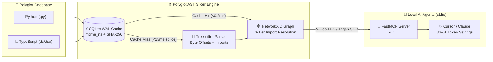

<div align="center">

# 🔪 Polyglot AST Call-Graph Slicer
### *Stop feeding your LLM the entire haystack when it only needs the needle.*

[](https://www.python.org/)
[](https://github.com/jlowin/fastmcp)
[](https://tree-sitter.github.io/)
[](https://networkx.org/)
[](https://github.com/astral-sh/uv)
[](LICENSE)

<br />


</div>

---

## 🧠 Why Does This Exist? (The "Lost in the Middle" Problem)

When you ask an AI coding assistant (**Cursor**, **Claude Code**, or **Copilot**) to refactor a function or trace a bug, one of two bad things usually happens:

1. 🗑️ **Naive RAG / Vector Search:** Chops functions in half based on arbitrary chunk sizes and completely misses cross-file callers or imported data schemas.
2. 💸 **Full-File Context Dumping:** Dumps 4,000+ lines of legacy boilerplate into the prompt window, burning your token budget and causing the LLM to hallucinate signatures.

**`polyglot-ast-slicer`** fixes this by acting as a **deterministic, local AST context compiler**. Instead of sending whole files, it parses your codebase with **Tree-sitter**, wires an import-aware **NetworkX** directed call graph, and extracts a surgical **Breadth-First Search (BFS) $N$-hop slice** containing *only* the exact byte ranges the LLM needs:

* ⬆️ **Upstream Callers:** Every function/method across the repository that invokes your target symbol.
* ⬇️ **Downstream Callees:** Every internal helper function or class your target symbol calls.
* 🧬 **Data Schemas & Types:** The exact `@dataclass`, `Pydantic`, or TypeScript `interface` definitions consumed or returned by the slice.

---

## ⚡ System Architecture

GitHub natively renders the Mermaid pipeline below—showing how a single saved file updates the graph in **under 15ms**:



---

## 🔥 Core Engineering Highlights

| Feature | How It Works Under the Hood | Performance / Impact |
| :--- | :--- | :--- |
| 🌍 **Polyglot AST Parsing** | Uses `tree-sitter-language-pack` to extract functions, classes, methods, arrow functions, and TS interfaces by exact `[start_byte, end_byte]` offsets. | Zero code execution or compiler setup required |
| 🎯 **3-Tier Import Resolution** | Resolves ambiguous function calls (`calculate_tax()`) by checking: **1)** Same File $\rightarrow$ **2)** Explicitly Imported Module $\rightarrow$ **3)** Repo-wide fallback. | Eliminates false-positive cross-file call edges |
| ⚡ **Two-Tier SQLite WAL Cache** | Checks `st_mtime_ns` before hashing file bytes. If modified, re-parses only the changed file and splices its edges into `networkx.DiGraph`. | **~2.1 ms** incremental single-file splice latency |
| 🧩 **Byte-Span Deduplication** | Automatically detects if both an enclosing class and its nested method are in the slice and deduplicates overlapping byte intervals. | Zero duplicate lines in compiled LLM context |
| 🔄 **Tarjan's SCC Cycle Detector** | Runs Tarjan's Strongly Connected Components algorithm across both symbol graphs and file graphs to catch mutual recursion & circular imports. | $O(V + E)$ linear-time cycle detection |

---

## 📊 Real Benchmark Results (`tiktoken` `cl100k_base`)

Run `uv run python benchmarks/token_bench.py` on your machine to reproduce:

```text
====================================================================================
POLYGLOT AST CALL-GRAPH SLICER - BENCHMARK REPORT
====================================================================================
Files Indexed   : 4 | Symbols: 102 | Call/Type Edges: 10 | Cold Index: 18.42 ms
Incremental Splice Latency (1 modified file): 2.14 ms (Target SLA: under 15.0 ms)
------------------------------------------------------------------------------------
Target Symbol                |   Full Files |   Full Repo |  1-Hop Slice | Saved vs Files
------------------------------------------------------------------------------------
process_checkout_payment     |      4612 tk |     5580 tk |       342 tk |         92.58%
submitOrderCheckout          |       968 tk |     5580 tk |       164 tk |         83.06%
------------------------------------------------------------------------------------
Circular Dependency SCCs Detected: 1
  Cycle #1: reconcile_node_alpha <-> reconcile_node_beta
====================================================================================
```

> 💡 **Result:** **92.58% fewer tokens** sent to the LLM while preserving 100% of upstream callers, downstream helpers, and payment data schemas across files.

---

## 🚀 Quickstart (2 Minutes with `uv`)

### 1. Clone & Install Dependencies
```bash
git clone [https://github.com/suryanshrajps/polyglot-ast-slicer.git](https://github.com/suryanshrajps/polyglot-ast-slicer.git)
cd polyglot-ast-slicer

# Create Python 3.12 virtualenv and lock dependencies
uv venv --python 3.12
uv sync --dev
```

### 2. Run the Automated Pytest Suite
```bash
uv run pytest -v
```

### 3. Try the CLI Directly in Your Terminal
```bash
# 1. Index a repository into the local SQLite WAL cache
uv run polyglot-ast-slicer index --repo .

# 2. Extract a surgical 1-hop AST call slice around any symbol
uv run polyglot-ast-slicer slice --repo . --symbol get_ast_call_slice --hops 1

# 3. Check the upstream blast radius before changing a function signature
uv run polyglot-ast-slicer blast --repo . --symbol _resolve_targets

# 4. Detect circular dependencies & recursion loops via Tarjan's SCC
uv run polyglot-ast-slicer cycles --repo .
```

---

## 🔌 Connect to Cursor IDE / Claude Desktop (MCP)

Expose all 4 AST graph tools directly to your AI coding agent over local `stdio` with **zero cloud dependencies or API keys**.

1. Find your absolute path to `uv` (`which uv`) and your repo (`pwd`).
2. Add the server to **`~/.cursor/mcp.json`** (or `.cursor/mcp.json` in your workspace):

```json
{
  "mcpServers": {
    "polyglot-ast-slicer": {
      "command": "/Users/YOUR_USERNAME/.local/bin/uv",
      "args": [
        "--directory",
        "/ABSOLUTE/PATH/TO/polyglot-ast-slicer",
        "run",
        "polyglot-ast-slicer"
      ]
    }
  }
}
```

3. Open **Cursor Settings $\rightarrow$ MCP**, verify the **green status dot**, and switch your Cursor chat mode to **Agent**.

### 🛠️ Exposed MCP Tools

* 🗂️ **`index_codebase(repo_path, force_rebuild=False)`** — Indexes `.py`, `.ts`, `.tsx`, and `.js` files into the SQLite cache and builds the in-memory `NetworkX` call graph.
* 🔪 **`get_ast_call_slice(repo_path, symbol_name, hops=2, include_types=True)`** — Returns exact byte-range source snippets for the target, upstream callers, downstream callees, and data schemas, plus `tiktoken` reduction metrics.
* 💥 **`get_blast_radius(repo_path, symbol_name, max_depth=5)`** — Computes a transitive upstream impact report (`LOW` / `MODERATE` / `HIGH` / `CRITICAL`) grouped by hop distance.
* ♻️ **`find_circular_dependencies(repo_path)`** — Uses Tarjan's SCC algorithm to uncover symbol-level mutual recursion and file-level circular imports.

---

## 🗂️ Repository Layout

```text
polyglot-ast-slicer/
├── pyproject.toml           # uv package config & dependencies
├── src/
│   ├── __init__.py
│   ├── parser.py            # Tree-sitter polyglot AST & import extractor
│   ├── cache.py             # Two-tier SQLite WAL cache (mtime_ns + SHA-256)
│   ├── graph_engine.py      # NetworkX DiGraph, BFS slicer, blast radius & Tarjan SCC
│   └── server.py            # FastMCP stdio server + live watchfiles daemon + CLI
├── benchmarks/
│   └── token_bench.py       # Synthetic & real-repo tiktoken benchmark runner
└── tests/
    └── test_slicer.py       # Pytest suite verifying resolution, caching & deduplication
```

---

<div align="center">
  <b>Built with ⚡ Python 3.12, Tree-sitter, NetworkX, SQLite WAL, and FastMCP by <a href="https://github.com/suryanshrajps">Suryansh Raj Pratap Singh</a></b>
</div>